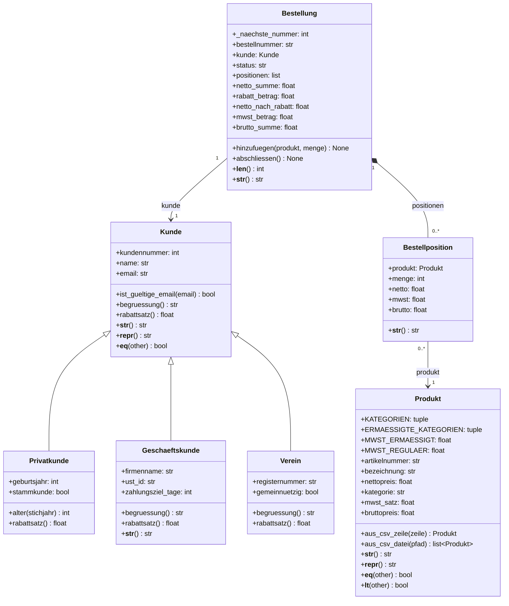

# Bestelo – Gruppe 5

> Allgemeines Shopsystem in Python · Programmieren 2 (BW220) · Hochschule für Wirtschaft und Gesellschaft Ludwigshafen

**Projektidee:** Bestelo bildet die grundlegenden Abläufe eines Shopsystems mit Kunden, Produkten, Bestellpositionen und Bestellungen in Python ab.

## Team

Bitte vor der Abgabe die tatsächlichen Namen und GitHub-Benutzernamen ergänzen und die Teamleitung markieren. Die Rollen und Klassenzuordnungen entsprechen der Aufgabenbeschreibung.

| Name | GitHub-Name | Rolle | Eigene Klassen / Dateien |
|---|---|---|---|
| Ibtihal | noch einzutragen | 1 und 5 | `Kunde`, `Privatkunde`, Demo, README, UML, Integrationstests, QA |
| Fadi | noch einzutragen | 2 und 3 | `Geschaeftskunde`, `Verein`, `Produkt`, `daten/produkte.csv` |
| Denis | noch einzutragen | 4 | `Bestellposition`, `Bestellung` |

*Eine Teamleitung wurde bisher nicht festgelegt. Bitte vor der endgültigen Abgabe im Team bestimmen und in dieser Tabelle markieren.*

## So starten Sie

Voraussetzung: Python 3.10 oder neuer. Im obersten Projektordner ausführen:

```bash
python -m pip install pytest
python -m pytest
python -m bestelo
```

Das Projekt verwendet außer pytest nur die Python-Standardbibliothek. Die Produktdatei wird relativ zum Python-Modul geladen, unabhängig vom aktuellen Arbeitsverzeichnis.

## UML-Klassendiagramm



## Geschäftsregeln

- Privatkunde: 0 % Rabatt, als Stammkunde 2 %.
- Geschäftskunde: 3 % Rabatt.
- Gemeinnütziger Verein: 5 % Rabatt, sonst 2 %.
- Lebensmittel und Bücher: 7 % MwSt.; alle anderen Kategorien: 19 %.
- Der Rabatt reduziert den Nettobetrag und anteilig die Mehrwertsteuer.
- Geldbeträge werden mit `round(betrag, 2)` auf Cent gerundet.
- Bestellungen sind zunächst offen. Leere Bestellungen können nicht abgeschlossen werden; abgeschlossene Bestellungen können nicht mehr geändert werden.

## Qualitätssicherung

Zur Qualitätssicherung wurden folgende Prüfungen durchgeführt:

- Automatisierte Tests mit `pytest` ausgeführt.
- Alle 34 Tests erfolgreich bestanden.
- Integrationstest für das Einlesen der Produktdaten aus der CSV-Datei durchgeführt.
- Berechnung der Beispielbestellungen überprüft.
- Konsolen-Demo mit `python -m bestelo` erfolgreich ausgeführt.
- Projektstruktur und benötigte Dateien kontrolliert.

**Testergebnis:** 34 Tests bestanden. Die Konsolen-Demo wurde erfolgreich ausgeführt.

## Ideen für Phase 2

- Produkte und Bestellungen dauerhaft in einer Datenbank speichern.
- Eine Web-API und eine grafische Benutzeroberfläche ergänzen.
- Auswertungen zu Umsatz, Produktkategorien und Kundenbestellungen bereitstellen.
- Geldbeträge für kaufmännisch exakte Berechnungen mit `Decimal` modellieren.

## Hinweis zur Abgabe

Vor dem Push müssen die Teamdaten ergänzt, alle Tests ausgeführt und der Git-Verlauf der tatsächlichen Teammitglieder geprüft werden. Der Tag `phase-1` darf erst auf dem gemeinsam geprüften Abgabestand gesetzt werden.
